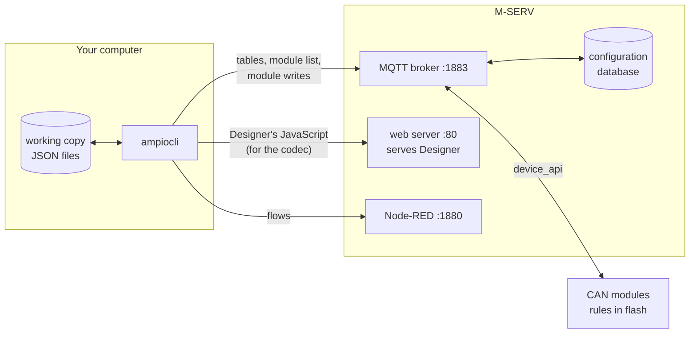
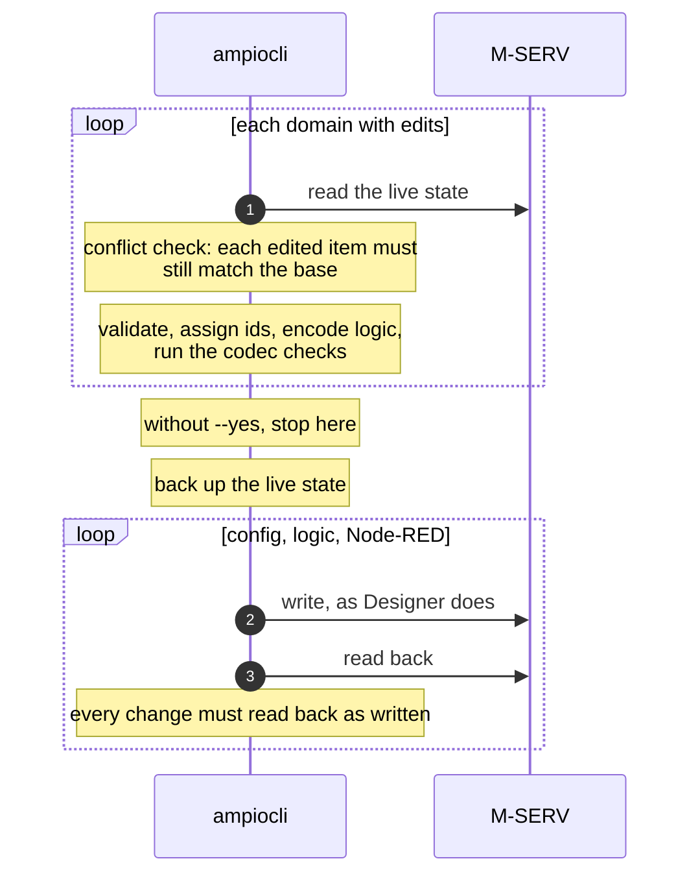
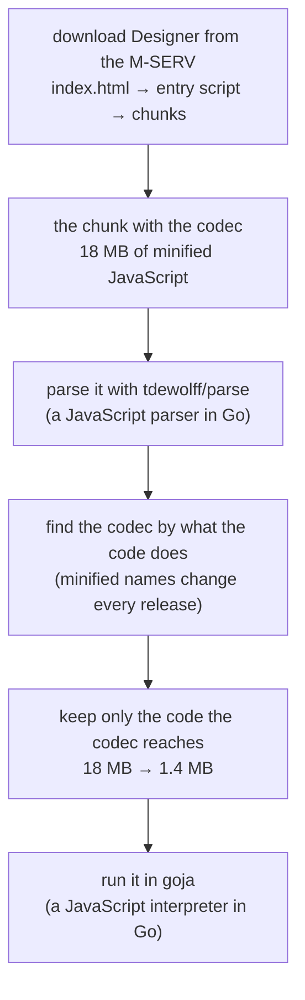

# ampiocli

Change an Ampio installation without opening Designer. ampiocli reads the M-SERV into plain files and writes your edits back, so you can:

- **Edit the app.** Add, rename, regroup or hide objects and groups.
- **Edit module logic.** Change, add or switch off the rules a CAN module runs, as readable JSON instead of Designer's rule editor.
- **Edit Node-RED.** Change flows or add new ones.
- **Search the whole house.** Find every rule and flow that uses flag 12, or every object in the kitchen, with one grep.
- **Make bulk changes.** Rename 40 objects to English, or give each bedroom the same tiles, in one edit.
- **Keep a history.** Commit the folder to git after each pull and you have a record of every change, including the ones made in Designer.

You see every change before it's written, a backup is taken first, and each write is read back and checked. Scripts and coding agents can use it the same way, and `SKILL.md` tells an agent how.

| Files | What they hold |
|---|---|
| `config/<table>.json` | What the Ampio app shows: objects, groups, locations, icons, flags |
| `logic/<mac>.json` | The rules each CAN module runs on its own |
| `nodered/<tab>.json` | The Node-RED flows on the M-SERV |

It talks to the M-SERV exactly as Designer does, over the same MQTT topics, and it encodes module rules with Designer's own code.

```
$ ampiocli pull
config: 10 files
logic: 23 files
nodered: 10 files

$ ampiocli diff
config: 1 changed
  ~ config/objects/6  "KITCHEN"
      opis_menu: "KITCHEN" → "Kitchen ceiling"
logic: 1 changed
  ~ logic/21dc1  "Rolety"
      rules[0].disabled: false → true

$ ampiocli push            # every check against the live M-SERV; writes nothing
$ ampiocli push --yes      # backup, write, read back, verify
backup: .ampiocli/backups/2026-11-25T14-02-11
config: written and verified
logic: written and verified
```



## The working copy

```
config/objects.json       one file per table, rows as the M-SERV stores them
logic/21dc1.json          one module's rules, decoded: {"name", "protocol", "rules"}
nodered/recuperator.json  one Node-RED tab: the tab node, then its nodes
devices.json              the module list (reference only)
blobs/<hash>.b64          long base64 values such as icons, referenced as "blob:<hash>"
.ampiocli/base/           the files as last pulled
.ampiocli/backups/        the M-SERV's state just before each push
```

The base is the M-SERV as it was at the last pull, so `diff` works offline. Every file is split into items: a table row (`config/objects/6`), a module's logic (`logic/21dc1`) or a Node-RED node. Diffs, conflict checks and verification all work on items, so the three domains share that code.

A new config row gets a placeholder id such as `"@hall_light"`. Push gives it the table's next free id. Any other row that refers to the placeholder in an id column (`id_obiektu`, `id_grupy`, `lokalizacja`, ...) gets the same id. That way a new object and its group membership can go in one push.

## How a push works



Every domain is checked before the first write, so a bad edit stops the push with nothing written. If a write fails part-way, new rows already have their final ids in the working copy. Running `push --yes` again skips what the M-SERV already has and writes the rest once. `ampiocli restore <backup>` puts a backup into the working copy, and the next push writes it back.

## Module logic: Designer's own codec

A module stores its rules as two byte tables: the conditions, and a linked table that rules with several inputs point into. The format is only documented in code, inside Designer. Rather than guess at it with a new encoder, ampiocli runs Designer's own code, without a browser:



The codec is recognised by its shape. Designer's logic save function encodes, stores the bytes in its device registry, and returns a decode:

```js
save(mac, rules) {
  const bytes = ENCODE(mac, rules)
  REGISTRY.updateConditionsArrByMacUniq(mac, bytes)
  ...
  return DECODE(mac, bytes)
}
```

Three more patterns find the registry's start-up, the codec's start-up and device registration. Each pattern must match exactly once. Otherwise ampiocli stops with "Designer changed" instead of guessing.

From those names it keeps every top-level declaration they reach, following imports into other chunks, the way a linker keeps only the functions a program calls. Top-level statements that modify something kept, such as a library's set-up, are kept too. Rendering and event wiring are left out. The result runs in goja with no network or file access. Designer is cached per M-SERV and never stored in this repository, so after an Ampio update the next run uses the new codec.

Before writing a module, ampiocli refuses unless two checks pass:

1. **Self-test.** Decode the module's current bytes and encode them again. The result must equal the stored bytes exactly, which proves the codec handles this module.
2. **Round trip.** The new bytes must decode back to exactly the edited rules. A field the module can't store is reported by name:

```
logic/21dc1: the edited rules do not survive encoding (unknown field or value out of range; copy an existing rule and change it):
  rules[0].action.params.val: 999 → (none)
```

On the installation it was built on, all 8 programmed modules re-encode byte for byte. Loading the codec takes about 1.5 s.

## Safety

| Risk | Guard |
|---|---|
| Someone changed the same thing in Designer since your pull | Per-item conflict check. Node-RED deploys also name the revision, so Node-RED refuses if someone deployed in between. |
| A bad edit gets half-written | Every domain is validated and encoded before the first write. |
| A push stops part-way | The next push skips what was written. Nothing is written twice. |
| The codec misreads a module, or can't store an edit | The self-test and the round trip above. |
| Rules too big for the module | Checked against the module's `conditionsMemSize`. |
| A write is acknowledged but not applied | Every change is read back and compared. |
| Undo | A backup before every push, and `restore`. |
| Logins | The `users`, `users_tokens` and `roles` tables are never read, and neither are Node-RED credentials. |

## Protocol reference

All over the M-SERV's MQTT broker, logged in as admin, as Designer does it.

| Action | Publish | Answer |
|---|---|---|
| Read a table | `ampio/control/admin/config` ← `<table>` | `ampio/fromDB/admin/config/<table>` → `{"List":[rows]}` |
| Save rows | `ampio/control/admin/config/save/<table>` ← `{"List":[rows]}`, changed rows marked `modifiedOrNew: true`, new rows `1`. `group_objects`, `connected_objects` and `locations` use `save/<table>_nc`, which also takes `{"idToRemove": id}`. | `ampio/fromDB/admin/config/statusSave/<code>` → `"0"` |
| App reload | `ampio/control/admin/data` ← `refresh` | none |
| Module list | `device_api/to/list` | `device_api/from/list` → `{"devices":[…]}`, logic as base64 |
| Write logic | `device_api/to/<mac>/conditions_wr` ← base64, then `linked_conditions_wr` if the linked table is not empty `device_api/from/<MAC>/status/<command>/0` → `{"p":100,"s":0}`, mac in upper case |

Save codes in Designer's save order: groups 2, group_objects 7, resources 4, connected_objects 1, locations 8, objects 6, flag_conditions 10, data 9.

## Limits

- Objects and groups can't be deleted; the M-SERV has no delete for them. Designer hides them by setting bit 16 in `params`, and so does ampiocli.
- Rule descriptions in the `data` table are keyed by the rule's hash. Changing a rule's trigger or action detaches its description, as it does in Designer.
- Modules from protocol 25 on use a newer logic format and are left out.
- Scenes and app automations (`scenes`, `conditions`) are read but not written.
- **Tested:**
  - Reading everything live, and every check up to the write, against the live M-SERV.
  - Full writes against the simulator, including a replay of the Recuperator job on a simulator seeded with the backup taken before it. The replay covered 4 groups, 17 objects, 17 group memberships, a new Node-RED tab and 2 disabled nodes. The result matched the real installation exactly, ids included.
  - Writes on the real M-SERV, each undone with `restore`: renaming a group, changing a module rule and adding a Node-RED node. A module write is confirmed in about 1.5 s, and a whole push takes 3 to 4 s.

## Setup and development

One static binary with no runtime dependencies. Building it needs Go 1.26 or newer:

```
GOPRIVATE=github.com/daisied go install github.com/daisied/ampiocli@latest
```

Put the M-SERV's address and admin password in `.env` in the working-copy folder (see `.env.example`):

```
AMPIO_HOST=192.168.1.250
AMPIO_PASSWORD=...
```

`go test ./...` runs the real CLI against `internal/sim`, an in-memory stand-in M-SERV with the same topics and replies, and against a miniature Designer bundle in `testdata/designer` that has the same shapes as the real one. `ampiocli sim` serves your last pull the same way, so a push can be tried on a copy of the house first.

| Package | Role |
|---|---|
| `internal/engine` | pull, diff, push, restore: conflict checks, backup, verification |
| `internal/config`, `logic`, `nodered` | the three domains: read state, write changes |
| `internal/designer` | fetch Designer, slice out the codec, run it in goja |
| `internal/items` | flatten, diff and describe JSON |
| `internal/workdir` | the working copy on disk |
| `internal/mserv` | settings, and MQTT request/reply |
| `internal/sim` | the stand-in M-SERV |

`SKILL.md` teaches coding agents to use the tool safely.
