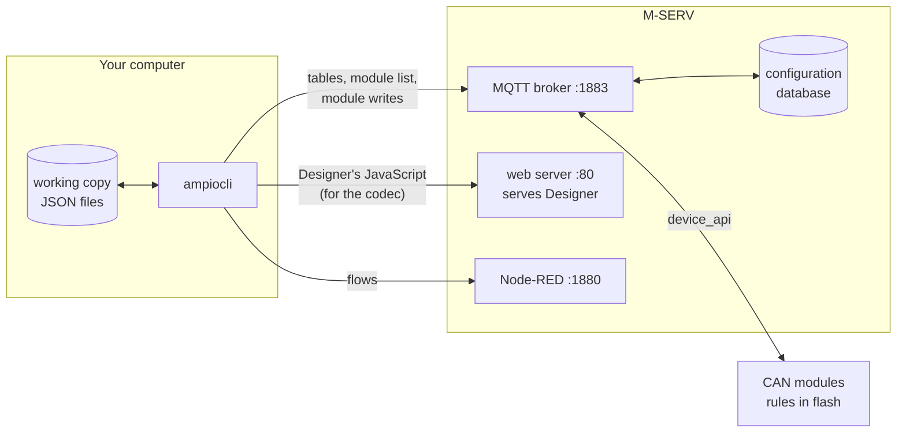
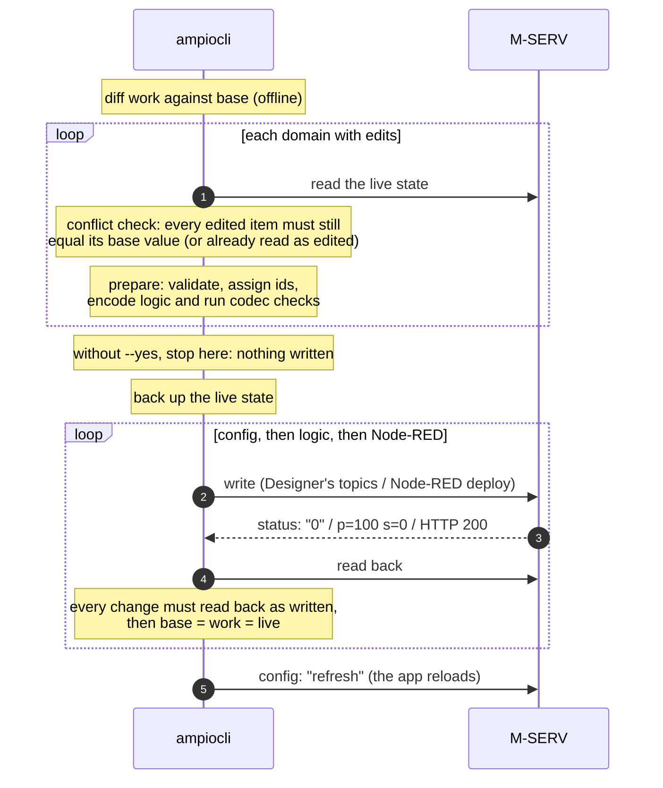
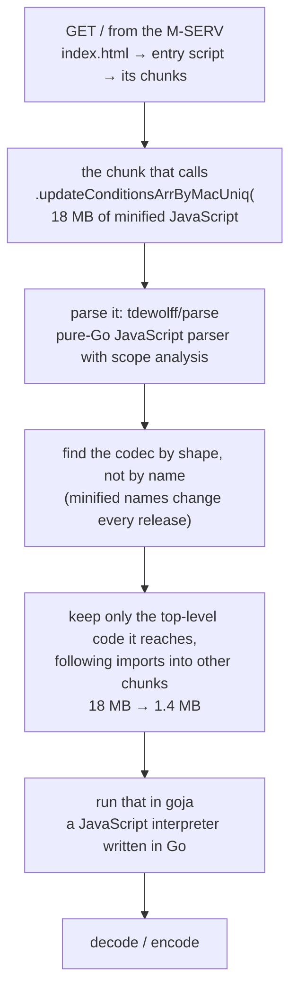

# ampiocli

Edit an Ampio installation as files. `ampiocli pull` reads the M-SERV's app configuration, the logic stored in every CAN module, and the Node-RED flows into a folder of JSON. You edit the files. `ampiocli diff` shows what changed, and `ampiocli push` writes it back with conflict checks, a backup and read-back verification.

It talks to the M-SERV the way Designer does, over the same MQTT topics, and it encodes module logic with Designer's own code. It does not use the cloud, scrape web pages, or write to the database directly.

```
$ ampiocli pull
config: 10 files
logic: 23 files
nodered: 10 files

$ ampiocli diff
config: 1 changed
  ~ config/objects/6  "KITCHEN"
      opis_menu: "KITCHEN" → "Kitchen ceiling"
logic: 1 changed
  ~ logic/21dc1  "Rolety"
      rules[0].disabled: false → true

$ ampiocli push            # checks everything against the M-SERV, writes nothing
$ ampiocli push --yes      # writes, reads back, verifies
backup: .ampiocli/backups/2026-11-25T14-02-11
config: written and verified
logic: written and verified
```

## Install

One static binary, no runtime dependencies (no Node.js, no browser). It needs Go 1.26 or newer:

```
GOPRIVATE=github.com/daisied go install github.com/daisied/ampiocli@latest
```

Make a folder for the working copy, and put the M-SERV's address and admin password in `.env` there (see `.env.example`):

```
AMPIO_HOST=192.168.1.250
AMPIO_PASSWORD=...
```

## What it manages

| Domain | What it is | Files | Transport |
|---|---|---|---|
| `config` | What the Ampio app shows: objects, groups, locations, resources, flags, rule descriptions | `config/<table>.json` | MQTT, `ampio/control/admin/config/...` |
| `logic` | The rules ("warunki") each CAN module runs on its own | `logic/<mac>.json`, `devices.json` | MQTT, `device_api/...` |
| `nodered` | Flows of the Node-RED on the M-SERV | `nodered/<tab>.json` | HTTP, Node-RED admin API |



## The working copy

```
devices.json            the module list as the M-SERV reports it (reference only)
config/objects.json     one file per table, rows as the M-SERV stores them
logic/21dc1.json        one module's rules, decoded: {"name", "protocol", "rules"}
nodered/recuperator.json  one Node-RED tab: its tab node, then its nodes
nodered/global.json     configuration nodes that belong to no tab
blobs/<hash>.b64        long base64 values (icons, photos), referenced as "blob:<hash>"
.ampiocli/base/         the same files as last pulled
.ampiocli/backups/      the M-SERV's state just before each push
```

It works like a version-control checkout. The base is what the M-SERV looked like at the last pull, so `diff` needs no connection. Every file is flattened into items: one table row (`config/objects/6`), one module's logic (`logic/21dc1`) or one Node-RED node (`nodered/8624995da5befa28`). Diffing, conflict checks and verification all work on items, so the three domains share that code.

New config rows get a placeholder id such as `"@hall_light"`. On push it becomes the table's next free id, after the live rows and any new rows numbered by hand. An id column of another new or changed row (`id_obiektu`, `id_grupy`, `lokalizacja`, ...) holding the same placeholder gets the same id, so an object and its group membership can be created in one push.

## Push, step by step



Every domain is prepared before anything is written, so an edit that fails validation stops the whole push with nothing written. If a write fails, the push stops there and prints the backup folder. Before writing, new rows get their final ids in the working copy too, so running `push` again finishes the job: edits the M-SERV already has are skipped, and nothing is written twice. `ampiocli restore <backup>` puts a backup into the working copy, and a `push` then writes it back.

## Module logic: using Designer's codec without a browser

A module stores its rules as two byte tables: the conditions, and a linked-condition table that rules with several inputs point into. Ampio documents the format only in code, inside Designer. Rewriting that encoder would mean guessing at an undocumented format, so ampiocli runs Designer's own code instead:



The codec is found by what the code does. Designer's logic save function encodes, stores the bytes in its device registry, and returns a decode of them:

```js
save(mac, rules) {
  const bytes = ENCODE(mac, rules)
  REGISTRY.updateConditionsArrByMacUniq(mac, bytes)
  ...
  return DECODE(mac, bytes)
}
INIT_REGISTRY = () => { REGISTRY = new ... }
INIT = () => { ...; INIT_REGISTRY(); ... }      // Designer's codec start-up
ADD_DEVICE = (row) => { REGISTRY.addNewDevice(...); ... .parseAndAddGroupsFromDev(...) }
```

Each pattern must match exactly once, or ampiocli stops with "Designer changed". It never guesses. From those five names it keeps every top-level declaration they reach, plus the `window.X = ...` globals they read. This is the same reachability analysis a linker does. The parser's scope analysis tells a reference to a top-level name apart from a local variable that happens to share it. Top-level statements that change something kept, such as a library's set-up (`Long.fromInt = ...`), are kept too, because the browser would have run them. The rest (rendering, event wiring, loading React) only reads and is left out.

Each chunk becomes a module function that runs once, in strict mode, however many chunks import it, as an ES module does in the browser. The result runs in goja with two small stand-ins: `window`, and the one shared library the codec imports (zustand, a 20-line state store). It has no network or file access.

Designer is downloaded from your own M-SERV and cached per M-SERV, and never copied into this repository. When Ampio updates Designer, ampiocli uses the new codec on the next run.

Before writing a module, ampiocli runs two checks, and refuses on either:

1. **Self-test.** Decode the module's current tables, encode the result, and compare. The conditions must equal the stored bytes exactly, byte for byte. That proves the codec reads and writes this module type correctly.
2. **Round trip of the edit.** The new tables must decode back to exactly the edited rules. A field the module can't store, or a value out of range, is reported by name:

```
logic/21dc1: the edited rules do not survive encoding (unknown field or value out of range; copy an existing rule and change it):
  rules[0].action.params.val: 999 → (none)
```

On the installation ampiocli was built on, the self-test is byte-exact for all 8 programmed modules, and both linked tables in use round-trip. Opening the codec takes about 1.5 s.

## Safety

| Risk | Guard |
|---|---|
| Someone changed the same thing in Designer since your pull | Conflict check per item against the base. Node-RED deploys also name the revision read just before, and Node-RED answers 409 if someone deploys in between. |
| A bad edit gets half-written | All domains are validated and encoded before the first write. |
| A push stops part-way (a refused save, a lost connection) | New rows already carry their ids in the working copy, and the next push skips what the M-SERV has. Nothing is written twice. |
| The codec misreads a module | Per-module self-test, byte-exact. |
| An edit the module can't represent | The decode(encode(edit)) == edit check, with the failing fields named. |
| Rules too big for the module | Checked against the module's `conditionsMemSize`. |
| A write acknowledged but not applied | Every changed item is read back and compared. |
| Undo | Backup before every push, plus `restore`. |
| Logins | The `users`, `users_tokens` and `roles` tables are never read. Node-RED credentials are never read, and nodes keep theirs. |
| Accidental write | `push` alone writes nothing. Only `push --yes` writes. |

## Protocol reference

All on the M-SERV's MQTT broker, logged in as the admin user, as Designer does it.

| Action | Publish | Answer |
|---|---|---|
| Read a table | `ampio/control/admin/config` ← `<table>` | `ampio/fromDB/admin/config/<table>` → `{"List":[rows]}` |
| Save rows | `ampio/control/admin/config/save/<table>` ← `{"List":[rows]}`. Changed rows carry `modifiedOrNew: true`, new rows `1`. | `ampio/fromDB/admin/config/statusSave/<code>` → `"0"` |
| Remove rows (`group_objects`, `connected_objects`, `locations`) | `…/save/<table>_nc` ← `{"List":[{"idToRemove":id}]}` | as above |
| App reload | `ampio/control/admin/data` ← `refresh` | none |
| Module list | `device_api/to/list` | `device_api/from/list` → `{"devices":[…]}`, logic as base64 in `conditions` |
| Write logic | `device_api/to/<mac>/conditions_wr` ← base64 | `device_api/from/<mac>/status/conditions_wr` → `{"p":percent,"s":status}`, done at p=100 s=0 |
| Write linked logic | `…/linked_conditions_wr`, only when non-empty | same pattern |

Save codes, in Designer's save order: groups 2, group_objects 7, resources 4, connected_objects 1, locations 8, objects 6, flag_conditions 10, data 9.

## Limits

- **Deleting** objects and groups: the M-SERV has no delete for those tables. Designer hides them by setting the DELETED bit (16) in `params`, and ampiocli asks you to do the same.
- **Rule descriptions** in the `data` table are keyed by the rule's hash. Changing a rule's trigger or action detaches its description, and Designer behaves the same.
- **Protocol 25+ modules** store logic in a newer format that Designer writes through another API. They are left out.
- **Scenes and app automations** (`scenes`, `conditions`) are pulled for reference but not written yet.
- **Tested so far:** reading everything live, every check up to the write (`push` without `--yes`) against the live M-SERV, and full writes against the simulator. Writes to a real M-SERV are not tested yet.

## Development

```
go test ./...
```

The tests run the real CLI against `internal/sim`, an in-memory stand-in M-SERV: an MQTT broker and HTTP server with the same topics and replies. The sim is seeded with `testdata/house`. `testdata/designer` is a miniature Designer bundle with the same shapes as the real one: save function, registry, start-up, device registration, a linked table, a chunk imported by two others, shared zustand, a `window` global and set-up code. It also has browser-only code that the slicer must leave out. The whole pipeline is covered without the real bundle.

`ampiocli sim` serves your last pull the same way on local ports. Point a second working copy at it to try a push on a copy of the house.

| Package | Role |
|---|---|
| `internal/engine` | pull, diff, push, restore: conflict checks, backup, verification |
| `internal/config`, `internal/logic`, `internal/nodered` | the three domains: read state, write changes |
| `internal/designer` | fetch Designer, slice out the codec, run it in goja |
| `internal/items` | flatten, diff and describe JSON state |
| `internal/workdir` | the working copy on disk |
| `internal/mserv` | settings, and MQTT request/reply |
| `internal/sim` | the stand-in M-SERV |

`SKILL.md` teaches coding agents (Claude Code and others) to use the tool safely.
