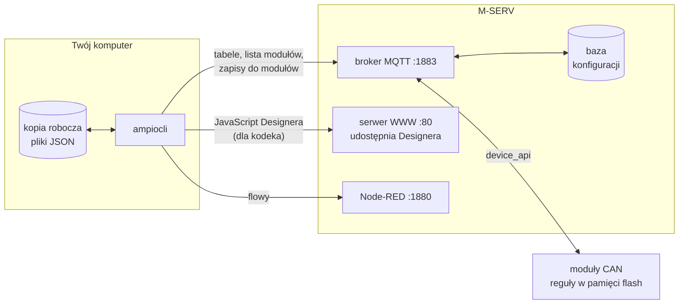
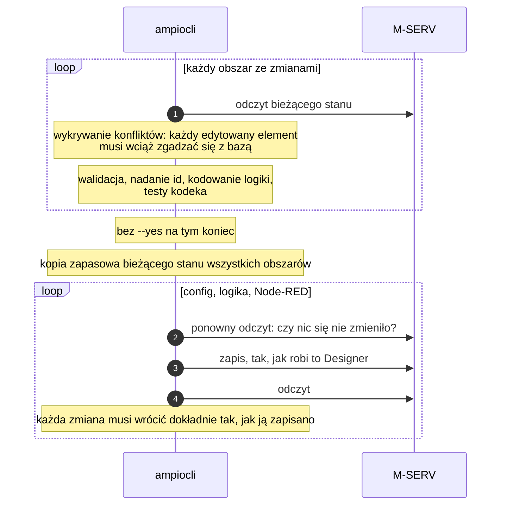
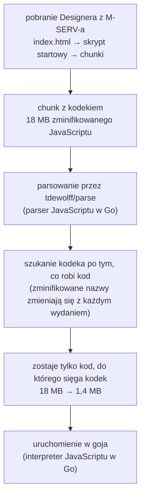

# ampiocli

[EN](README.md) · **PL**

Zmieniaj instalację Ampio bez otwierania Designera. ampiocli odczytuje M-SERV do zwykłych plików i zapisuje z powrotem to, co w nich zmienisz. Dzięki temu możesz:

- **Edytować aplikację.** Dodawać obiekty i grupy, zmieniać ich nazwy, przenosić między grupami i ukrywać.
- **Edytować logikę modułów.** Zmieniać, dodawać i wyłączać reguły, które wykonuje moduł CAN, w czytelnym JSON-ie zamiast w edytorze reguł Designera.
- **Edytować Node-RED.** Zmieniać istniejące flowy albo dodawać nowe.
- **Przeszukiwać cały dom.** Jednym grepem znajdziesz każdą regułę i każdy flow, który używa flagi 12, albo każdy obiekt w kuchni.
- **Robić zmiany hurtem.** Przetłumaczyć nazwy 40 obiektów na angielski albo dać każdej sypialni te same kafelki, wszystko w jednej edycji.
- **Mieć historię.** Commituj folder do gita po każdym pullu, a zostanie ci zapis każdej zmiany, także tych zrobionych w Designerze. `pull` zapisuje `.gitignore`, który trzyma z dala od gita hasło (`.env`) i wewnętrzne pliki ampiocli.

Każdą zmianę widzisz, zanim trafi na serwer. Przed zapisem robiona jest kopia zapasowa, a każdy zapis jest potem odczytywany i sprawdzany. Skrypty i agenci AI mogą korzystać z narzędzia tak samo, a `SKILL.md` podpowiada agentowi, jak to robić.

| Pliki | Co zawierają |
|---|---|
| `config/<table>.json` | To, co pokazuje aplikacja Ampio: obiekty, grupy, lokalizacje, ikony, flagi |
| `logic/<mac>.json` | Reguły, które każdy moduł CAN wykonuje samodzielnie |
| `nodered/<tab>.json` | Flowy Node-RED na M-SERV-ie |

Z M-SERV-em rozmawia dokładnie tak jak Designer, przez te same topiki MQTT, a reguły modułów koduje kodem samego Designera.

```
$ ampiocli pull
config: 10 files
logic: 23 files
nodered: 10 files

$ ampiocli diff
config: 1 changed
  ~ config/objects/6  "HALL"
      opis_menu: "HALL" → "Hall ceiling"
logic: 1 changed
  ~ logic/1a2b3  "Blinds"
      rules[0].disabled: false → true

$ ampiocli push            # wszystkie sprawdzenia na żywym M-SERV-ie; nic nie zapisuje
$ ampiocli push --yes      # kopia zapasowa, zapis, odczyt, weryfikacja
backup: .ampiocli/backups/2026-11-25T14-02-11
config: written and verified
logic: written and verified
```



## Kopia robocza

```
config/objects.json       jeden plik na tabelę, wiersze w takiej postaci, w jakiej trzyma je M-SERV
logic/1a2b3.json          zdekodowane reguły jednego modułu: {"name", "protocol", "rules"}
nodered/ventilation.json  jedna zakładka Node-RED: najpierw węzeł zakładki, potem jej węzły
devices.json              lista modułów (tylko do wglądu)
blobs/<hash>.b64          długie wartości base64, np. ikony, wskazywane jako "blob:<hash>"
.ampiocli/base/           pliki z ostatniego pulla
.ampiocli/backups/        stan M-SERV-a tuż przed każdym pushem
.gitignore                trzyma .env i .ampiocli/ poza gitem
```

Baza to stan M-SERV-a z ostatniego pulla, więc `diff` działa offline. Każdy plik jest dzielony na elementy: wiersz tabeli (`config/objects/6`), logikę modułu (`logic/1a2b3`) albo węzeł Node-RED. Diff, wykrywanie konfliktów i weryfikacja działają na elementach, więc wszystkie trzy obszary korzystają z tego samego kodu.

Usunięcie wiersza z `objects.json` albo `groups.json` ukrywa go, bo M-SERV nie ma dla nich operacji usuwania. Push ustawia w `params` bit DELETED (16), tak jak Designer, a wiersz wraca do pliku z ustawionym bitem.

Nowy wiersz konfiguracji dostaje tymczasowe id, np. `"@hall_light"`. Przy pushu zostaje ono zamienione na następne wolne id w tabeli. Każdy inny wiersz, który odwołuje się do tego placeholdera w kolumnie z id (`id_obiektu`, `id_grupy`, `lokalizacja`, ...), dostaje to samo id. Dzięki temu nowy obiekt razem z przypisaniem do grupy można wysłać jednym pushem.

## Jak działa push



Wszystkie obszary są sprawdzane przed pierwszym zapisem, więc błędna edycja zatrzymuje push, zanim cokolwiek zostanie zapisane. Tuż przed zapisem każdego obszaru jego stan jest odczytywany jeszcze raz, więc zmiana zrobiona na M-SERV-ie w trakcie pusha zatrzymuje ten zapis. Jeśli zapis przerwie się w połowie, nowe wiersze mają już w kopii roboczej swoje docelowe id. Ponowne `push --yes` pomija to, co M-SERV już ma, i zapisuje resztę, każdą rzecz tylko raz. `ampiocli restore <backup>` wgrywa kopię zapasową do kopii roboczej, a następny push zapisuje ją z powrotem na serwerze. Jeśli w kopii roboczej są niewysłane zmiany, `restore` ich nie nadpisze bez `--force`.

## Logika modułów: kodek samego Designera

Moduł przechowuje reguły w dwóch tablicach bajtów: w warunkach oraz w tablicy powiązań, do której odwołują się reguły z kilkoma wejściami. Format jest opisany wyłącznie w kodzie Designera. Zamiast odtwarzać go na ślepo we własnym enkoderze, ampiocli uruchamia kod samego Designera, bez przeglądarki:



Kodek jest rozpoznawany po kształcie kodu. Funkcja Designera zapisująca logikę koduje reguły, zapisuje bajty w rejestrze urządzeń i zwraca wynik dekodowania:

```js
save(mac, rules) {
  const bytes = ENCODE(mac, rules)
  REGISTRY.updateConditionsArrByMacUniq(mac, bytes)
  ...
  return DECODE(mac, bytes)
}
```

Trzy kolejne wzorce wyszukują inicjalizację rejestru, inicjalizację kodeka i rejestrację urządzeń. Każdy wzorzec musi pasować dokładnie raz. Jeśli nie pasuje, ampiocli przerywa z komunikatem „Designer changed”, zamiast zgadywać.

Wychodząc od tych nazw, ampiocli zachowuje każdą deklarację najwyższego poziomu, do której da się z nich dojść, również przez importy z innych chunków. Działa to tak jak linker, który zostawia tylko funkcje faktycznie wywoływane przez program. Zostają też instrukcje najwyższego poziomu, które modyfikują coś zachowanego, np. inicjalizacja biblioteki. Renderowanie i obsługa zdarzeń wypadają. Wynik działa w goja bez dostępu do sieci i plików, z limitem czasu: minuta na start i 10 sekund na moduł. Designer jest cache'owany osobno dla każdego M-SERV-a i nigdy nie trafia do tego repozytorium, więc po aktualizacji Ampio kolejne uruchomienie korzysta już z nowego kodeka.

Zanim ampiocli zapisze cokolwiek do modułu, muszą przejść dwa testy:

1. **Autotest.** Bieżące bajty modułu są dekodowane i kodowane ponownie. Warunki muszą zgadzać się z zapisanymi bajtami co do bajtu, co dowodzi, że kodek poprawnie obsługuje ten moduł. Koder buduje tablicę powiązań od nowa na podstawie reguł, więc może pominąć wpisy, których żadna reguła nie używa, i tylko takie: warunki muszą się dekodować tak samo z nową tablicą.
2. **Test w obie strony.** Nowe bajty muszą się zdekodować dokładnie do edytowanych reguł. Pole, którego moduł nie potrafi zapisać, jest zgłaszane z nazwy:

```
logic/1a2b3: the edited rules do not survive encoding (unknown field or value out of range; copy an existing rule and change it):
  rules[0].action.params.val: 999 → (none)
```

Na instalacji, na której powstało narzędzie, każdy z 8 zaprogramowanych modułów przechodzi oba testy, a ich warunki kodują się ponownie bajt w bajt. Jeden moduł ma w tablicy powiązań nieużywane wpisy i push o tym informuje. Wczytanie kodeka trwa ok. 1,5 s.

## Bezpieczeństwo

| Ryzyko | Zabezpieczenie |
|---|---|
| Ktoś zmienił to samo w Designerze od twojego pulla | Wykrywanie konfliktów dla każdego elementu, powtarzane tuż przed zapisem każdego obszaru. Deploy do Node-RED podaje też numer rewizji, więc Node-RED go odrzuci, jeśli w międzyczasie ktoś zrobił deploy. |
| Ktoś doda wiersz w trakcie pusha | Id nowego wiersza musi być wciąż wolne tuż przed zapisem. |
| Błędna edycja zapisze się tylko w połowie | Każdy obszar jest walidowany i kodowany przed pierwszym zapisem. |
| Push zatrzyma się w połowie | Następny push pomija to, co już zostało zapisane. Nic nie jest zapisywane dwa razy. |
| Kodek źle odczyta moduł albo nie umie zapisać zmiany | Autotest i test w obie strony opisane wyżej. |
| Reguły nie mieszczą się w module | Sprawdzane względem `conditionsMemSize` modułu. |
| Zapis jest potwierdzony, ale nie został wykonany | Każda zmiana jest odczytywana z powrotem i porównywana. |
| Cofanie zmian | Kopia zapasowa wszystkich obszarów przed każdym pushem i `restore`. Nowe obiekty i grupy są ukrywane zamiast usuwane. |
| Dane logowania | Tabele `users`, `users_tokens` i `roles` nigdy nie są odczytywane, podobnie jak credentials w Node-RED. `pull` trzyma `.env` poza gitem. |
| Kod Designera się zawiesi | Działa z limitem czasu, a pierwsze Ctrl-C czysto zatrzymuje push. Drugie kończy program. |

## Protokół

Wszystko idzie przez broker MQTT na M-SERV-ie, po zalogowaniu jako admin, tak, jak robi to Designer.

| Akcja | Publikacja | Odpowiedź |
|---|---|---|
| Odczyt tabeli | `ampio/control/admin/config` ← `<table>` | `ampio/fromDB/admin/config/<table>` → `{"List":[rows]}` |
| Zapis wierszy | `ampio/control/admin/config/save/<table>` ← `{"List":[rows]}`, zmienione wiersze oznaczone `modifiedOrNew: true`, nowe `1`. `group_objects`, `connected_objects` i `locations` używają `save/<table>_nc`, które przyjmuje też `{"idToRemove": id}`. | `ampio/fromDB/admin/config/statusSave/<code>` → `"0"` |
| Przeładowanie aplikacji | `ampio/control/admin/data` ← `refresh` | brak |
| Lista modułów | `device_api/to/list` | `device_api/from/list` → `{"devices":[…]}`, logika jako base64 |
| Zapis logiki | `device_api/to/<mac>/conditions_wr` ← base64, a potem `linked_conditions_wr`, jeśli tablica powiązań nie jest pusta | `device_api/from/<MAC>/status/<command>/0` → `{"p":100,"s":0}`, MAC wielkimi literami |

Kody zapisu w kolejności, w jakiej zapisuje Designer: groups 2, group_objects 7, resources 4, connected_objects 1, locations 8, objects 6, flag_conditions 10, data 9.

## Ograniczenia

- Obiektów i grup nie da się usunąć, bo M-SERV nie ma dla nich operacji usuwania. Usunięcie obiektu albo grupy z pliku ukrywa go, tak jak w Designerze. Wierszy w `resources`, `flag_conditions` i `data` nie da się usunąć wcale.
- Opisy reguł w tabeli `data` są przypisane do hasha reguły. Zmiana wyzwalacza albo akcji reguły odłącza od niej opis, tak samo jak w Designerze.
- Moduły od protokołu 25 wzwyż używają nowszego formatu logiki i są pomijane. Podobnie każdy moduł, którego kodek Designera nie potrafi zdekodować; pull podaje jego nazwę.
- Sceny i automatyzacje aplikacji (`scenes`, `conditions`) są odczytywane, ale nie zapisywane.
- **Przetestowane:**
  - Odczyt wszystkiego na żywo oraz każde sprawdzenie aż do momentu zapisu, na działającym M-SERV-ie.
  - Pełne zapisy na symulatorze, w tym odtworzenie prawdziwych zmian w wentylacji na symulatorze załadowanym kopią zapasową sprzed tych zmian. Objęło to 4 grupy, 17 obiektów, 17 przypisań do grup, nową zakładkę Node-RED i 2 wyłączone węzły. Wynik zgadzał się z prawdziwą instalacją co do joty, łącznie z id.
  - Zapisy na prawdziwym M-SERV-ie, każdy cofnięty przez `restore`: zmiana nazwy grupy, zmiana reguły modułu i dodanie węzła Node-RED. Zapis do modułu jest potwierdzany po ok. 1,5 s, a cały push trwa 3–4 s.

## Instalacja i rozwój

Jedna statyczna binarka bez zależności w czasie działania. Do zbudowania potrzebny jest Go 1.26 lub nowszy:

```
go install github.com/daisied/ampiocli@latest
```

Adres M-SERV-a i hasło admina wpisz do pliku `.env` w folderze kopii roboczej (wzór w `.env.example`):

```
AMPIO_HOST=192.168.1.10
AMPIO_PASSWORD=...
```

`go test ./...` uruchamia prawdziwe CLI na `internal/sim`, czyli atrapie M-SERV-a działającej w pamięci, z tymi samymi topikami i odpowiedziami. Testy korzystają też z miniaturowego bundla Designera w `testdata/designer`, który ma te same kształty co prawdziwy. `ampiocli sim` w ten sam sposób serwuje twój ostatni pull, więc push możesz najpierw wypróbować na kopii domu. CI uruchamia testy z detektorem wyścigów i `govulncheck` przy każdym pushu do repozytorium.

Jeśli masz pod ręką pull prawdziwej instalacji, jeszcze jeden test przepuszcza każdy moduł przez prawdziwy kodek Designera, offline:

```
AMPIOCLI_REAL=ścieżka/do/kopii-roboczej AMPIOCLI_REAL_DESIGNER=~/.cache/ampiocli/designer/<host> go test ./internal/logic -run Real -v
```

| Pakiet | Rola |
|---|---|
| `internal/engine` | pull, diff, push, restore: wykrywanie konfliktów, kopia zapasowa, weryfikacja |
| `internal/config`, `logic`, `nodered` | trzy obszary: odczyt stanu, zapis zmian |
| `internal/designer` | pobieranie Designera, wycinanie kodeka, uruchamianie go w goja |
| `internal/items` | spłaszczanie, porównywanie i opisywanie JSON-a |
| `internal/workdir` | kopia robocza na dysku |
| `internal/mserv` | ustawienia oraz zapytania i odpowiedzi MQTT |
| `internal/sim` | atrapa M-SERV-a |

`SKILL.md` (po angielsku) uczy agentów AI bezpiecznego korzystania z narzędzia.

Licencja MIT, zobacz `LICENSE`.
